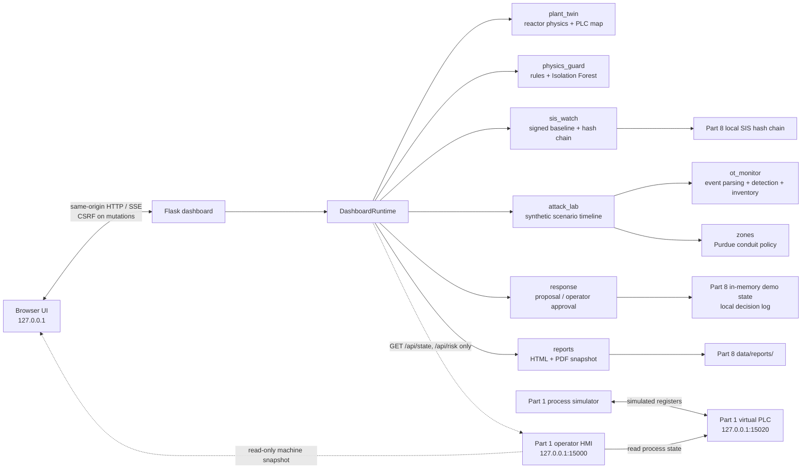
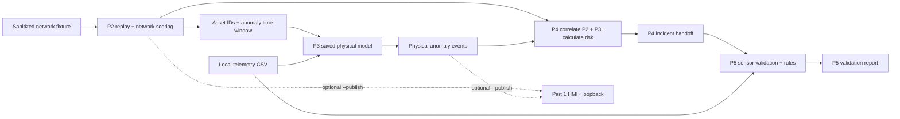

# Part 8 architecture

Part 8 is a standalone local application. The Flask dashboard coordinates
separate Python modules and serves a same-origin HTML/CSS/JavaScript client.
Its compact, navigable views keep the live overview separate from machine,
network/OT, detection, response, and backend detail panels.
The process twin and protocol scenarios are independent synthetic sources;
the existing Part 1 virtual machine is displayed from its HMI's read-only API.
The integrated machine and the local reactor twin are separate data sources.

## Data flow

1. `plant_twin` advances a deterministic reactor model using bounded local
   controls and publishes scaled values to an in-memory PLC-style map. The
   dashboard can pause/resume this model and adjust its simulated feed pump
   and coolant-valve target; the monitoring service remains online while the
   twin is paused.
2. `physics_guard` compares telemetry against rate, energy, mass, and
   cross-sensor rules and reports a separate locally trained Isolation Forest
   deviation score.
3. `attack_lab` steps through JSON event timelines. Its replay session passes
   only those supplied records to `ot_monitor`, `zones`, and `sis_watch`.
4. The dashboard reads machine status from the Part 1 HMI API while separately
   advancing the local reactor twin. Its first panel makes the simulator →
   virtual PLC → HMI → read-only dashboard path visible. Findings are
   correlated into a snapshot and SSE stream; scenario evidence, asset
   inventory, compliance checks, and response decisions remain local.
5. P8 summarizes network, OT-zone, AI/ML, alert, and SIS outputs from those
   local modules. It passes validated synthetic network and physical detector
   alerts to the existing P4 correlation and risk engine in memory; it does
   not write to the P4 incident store or combine distinct asset identities.
6. Operators can propose a response. The `response` module records a pending
   decision; only an explicit approve action applies its simulated effect.
7. `reports` turns a point-in-time dashboard snapshot into self-contained HTML
   and PDF files for local download.

## Existing P2–P5 offline pipeline

The dashboard includes a read-only guide to the repository's separate
file-backed runner, `scripts.run_chain`. This is not the Part 8 scenario
runtime and is not started by opening the dashboard.
P8's in-memory P4 analysis is a separate display path and does not start the
P2–P5 runner.

P3 uses the P2-selected telemetry window and saved physical model. P4
correlates P2 network events and P3 physical events. P5 checks the P4 incident
windows against telemetry with sensor validation and rules; it does not run
the P3 model again. The optional `--publish` flag sends the P2/P3 events to
the loopback HMI; P5 writes its report locally.

## Trust boundaries

- The Flask server is hard-bound to `127.0.0.1`; requests from non-loopback
  addresses are rejected. Mutating browser routes require CSRF validation.
- Existing CHEM-SHIELD integration is restricted to the validated Part 1 HMI
  loopback origin and GET requests. CSRF-protected P8 controls mutate only the
  local reactor twin; no Part 8 action is forwarded to the Part 1 HMI.
- Synthetic scenario IP addresses use documentation-only ranges. No packets,
  scans, firewall changes, or device commands are generated.
- Response, SIS, and report files are written under the Part 8 data directory.
- Compliance and ML outputs are demonstrative analysis, not formal
  certification or probability claims.

## Configuration and persistence

YAML under `config/` describes process tags and limits, OT-monitor rules,
physics settings, Purdue zones/conduits, and response playbooks. Scenario
timelines are in `attack_lab/scenarios.json`. Runtime keys, hash-chain logs,
response logs, and generated reports are stored in the ignored `data/`
directory.
